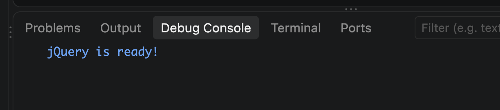
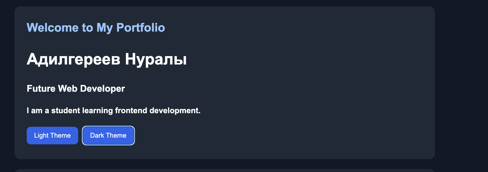
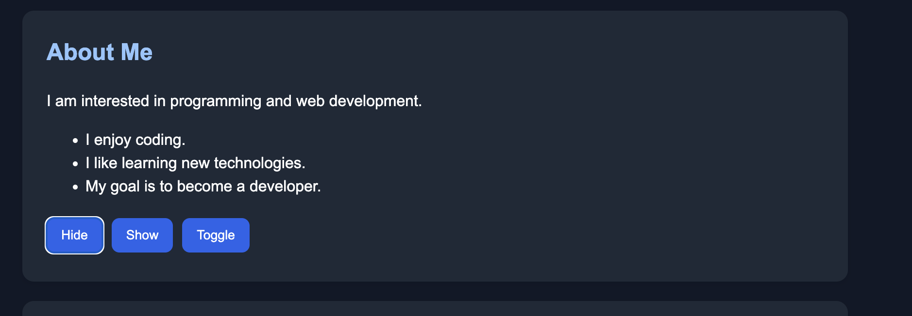
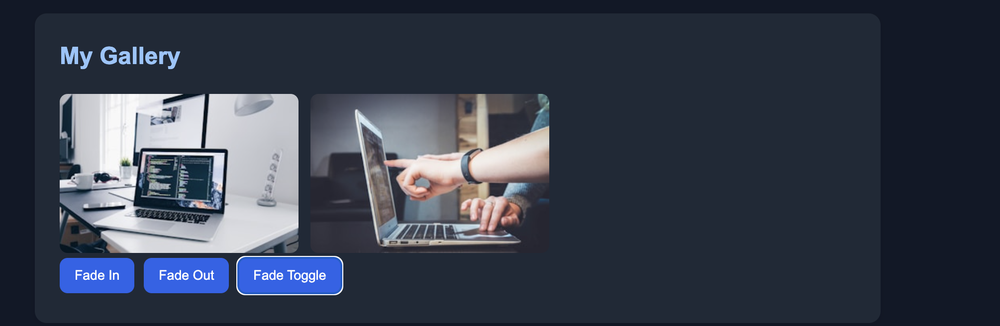
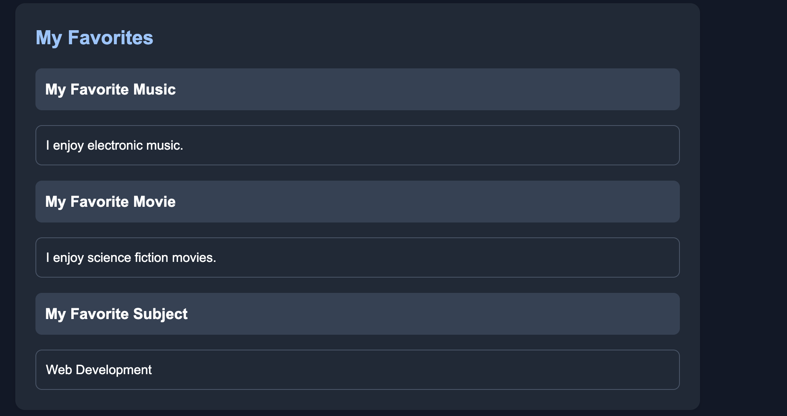
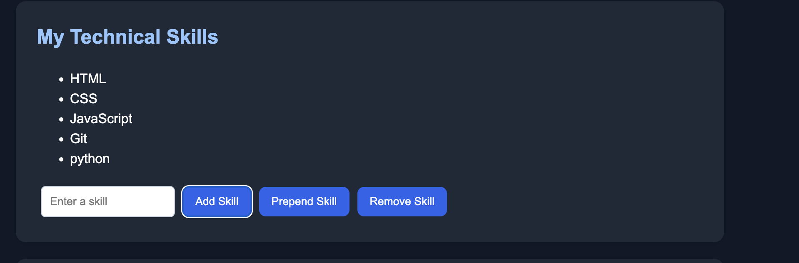
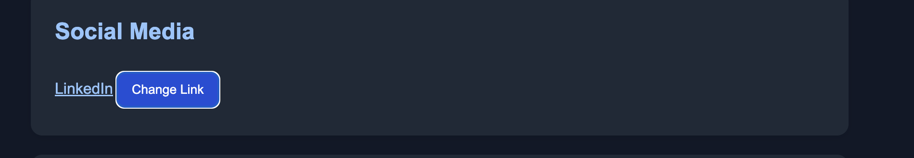
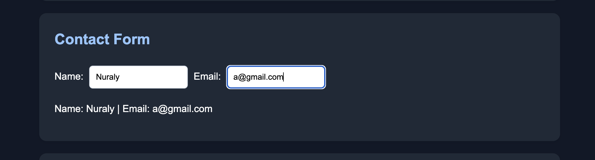
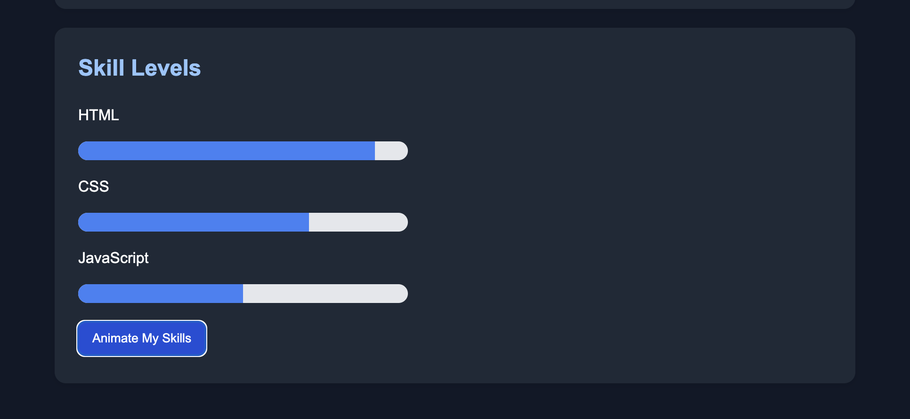

# Assignment 6 - jQuery

**Name:** Адилгереев Нуралы  
**Group:** 4

## Part 1. Getting Started with jQuery

### Task 0. Setup

Connected jQuery using CDN and used document.ready().

### Task 1. Selectors & CSS

Created a personal portfolio using jQuery selectors and added light and dark themes.

## Part 2. jQuery Effects

### Task 2. Visibility Methods

Implemented Hide, Show, and Toggle buttons.

### Task 3. Fade Methods

Added two images and implemented fadeIn(), fadeOut(), and fadeToggle().

### Task 4. Slide Methods

Created three collapsible panels using slideUp(), slideDown(), and slideToggle().

## Part 3. DOM Manipulation with jQuery

### Task 5. Add & Remove Elements

Created a skills list with Add, Prepend, and Remove buttons.

### Task 6. Modifying Attributes

Added a social media link that changes dynamically using attr().

### Task 7. Form Interaction

Created a form that displays Name and Email input in real time.

## Part 4. Animations

### Task 8. Basic Animation

Created three animated skill bars using animate().

## Summary

I created a personal portfolio using HTML, CSS, and jQuery. I implemented selectors, effects, DOM manipulation, form interaction, and animations. I tested the buttons and checked that the website works correctly.
